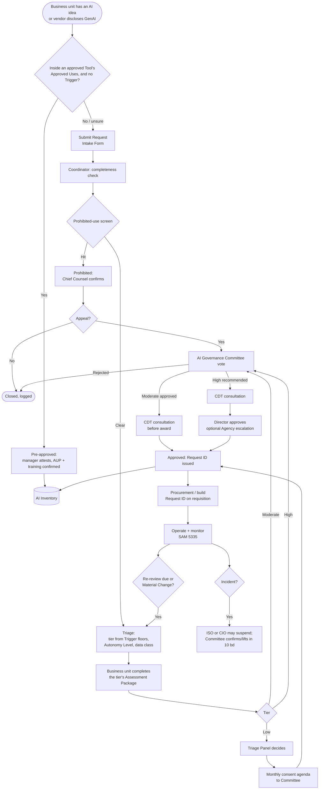
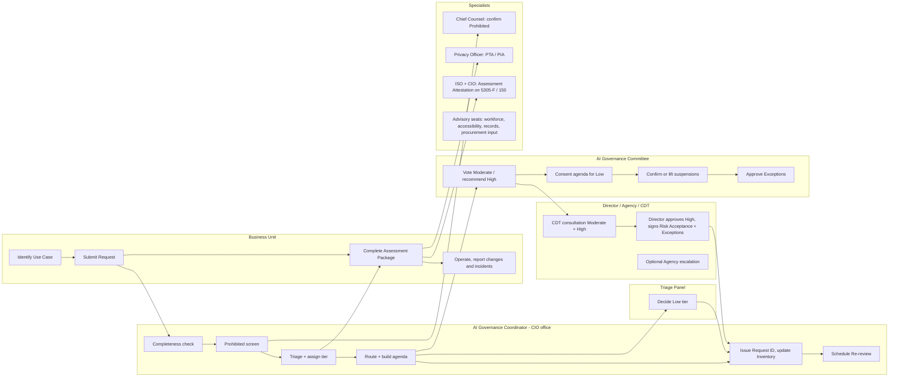
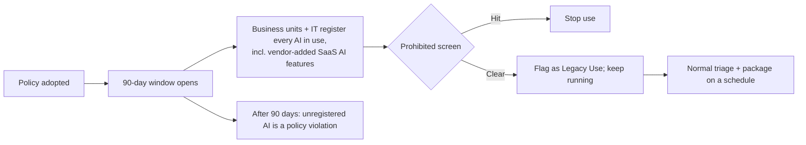

# AI Governance Procedure Map

**Status:** Draft for agreement, before any policy, procedure or form is written.
**Applies to:** California Executive Branch State Entities. Non-Executive Branch State Entities, including constitutional offices, should adopt it as written; see the [adoption note](./docs/Non-Executive-Branch-Adoption.md). Sections marked *(EB)* rest on Executive-Branch-only SAM chapters.
**Terms:** Every capitalised term is defined in [GLOSSARY.md](./GLOSSARY.md). Decisions behind the shape are in [docs/adr/](./docs/adr/).

> This map is not legal advice. Each citation should be checked against the current SAM, SIMM, SCM and Government Code before adoption.

---

## 1. The process on one page

---

## 2. Who does what (swimlanes)

---

## 3. Routing rules

### 3.1 Triggers that require a Request
A Use Case needs a Request (instead of Pre-approved) if **any** is true:
1. The Tool is not yet approved, or the Use Case falls outside its Approved Uses.
2. It uses confidential, sensitive or personal data (Civil Code 1798.3, 1798.29; classified under SAM 5305.5).
3. Its output is public-facing or goes to people outside the State Entity.
4. It informs or makes decisions about people (eligibility, benefits, enforcement, employment).
5. Its Autonomy Level is A2 or A3.
6. A vendor discloses GenAI under the SCM Vol. 2 Ch. 23 clause.
7. It affects employees' terms and conditions of employment, or how their work is monitored or evaluated.
8. It will be used by or about minors.

The authoritative list is the [Data and Tier Floor Standard](./standards/Data-and-Tier-Floor-Standard.md#2-triggers).

### 3.2 Tier floors
The Risk Tier is the **highest** of: the SIMM 5305-F result and every floor below.

| Factor | Floor |
|---|---|
| Matches a prohibited use (SAM 4986.12, prohibited-practice screen) | Prohibited |
| Public data, A0–A1, internal audience | none (Low unless 5305-F says otherwise) |
| SIMM 5305-F "Moderate" examples (code tools, chatbots, output supporting decisions in public programs) | Moderate |
| Public-facing output or interaction | Moderate |
| Confidential, sensitive or personal data | Moderate |
| A2 or A3 acting on production systems | Moderate |
| Affects employees' terms, conditions or monitoring | Moderate |
| Decisions about people, or high-risk ADS (GC 11546.45.5) | High |
| Access to housing, education, employment, credit, health care or criminal justice; public safety | High |
| FTI, CJI, PHI or other federally restricted data | High |
| Used by or about minors | High |
| A3 touching personal/confidential data, or acting toward the public or external parties | High |

### 3.3 Autonomy Levels
| Level | Name | What the AI does | Human role |
|---|---|---|---|
| A0 | Assist | Answers, suggests | Does the work |
| A1 | Draft | Produces output | Reviews before use (SAM 4986.12 human verification) |
| A2 | Act with approval | Takes actions | Approves each action |
| A3 | Act autonomously | Takes actions within set limits | Sets limits, monitors, can stop |

---

## 4. Tier matrix

| | Pre-approved | Low | Moderate | High |
|---|---|---|---|---|
| **Decider** | Requester's manager attests | Triage Panel | Committee vote | Committee recommends → Director approves |
| **CDT** (advises, does not approve) | Covered by the Tool's own assessment | Keep on file; via SITeS do not submit (PS-033); other routes per SAM 4986.9 | Submit; await CDT review, consult if requested | Submit; mandatory consultation; Agency escalation optional |
| **Target turnaround** (business days from complete package) | Immediate | 10 | 30 | 60 (excl. CDT time) |
| **Re-review** | When Approved Uses change | On Material Change | Every 2 years + Material Change | Yearly + Material Change |
| **Records seat reviews** | — | — | Yes | Yes |

### 4.1 Assessment Package (cumulative)
The authoritative, current list is in [Procedure 01, section 6](./procedures/01-Request-and-Approval.md#6-assessment-package).

| Item | Pre | Low | Mod | High | Authority |
|---|:-:|:-:|:-:|:-:|---|
| Acceptable Use acknowledgment | ● | ● | ● | ● | SAM 4986.12 |
| GenAI training completion | ● | ● | ● | ● | SAM 4986.13 |
| Intake Form (Use Case, Tool, Autonomy Level, data, audience) | | ● | ● | ● | SAM 4986.3 |
| SIMM 5305-F GenAI Risk Assessment **or** SIMM 150 (office productivity) | | ● | ● | ● | SAM 4986.7, 4986.9, 4986.11 |
| SIMM 5310-C Privacy Threshold Assessment | | ● | ● | ● | SAM 4986.9, 4986.10 |
| SIMM 5310-C Privacy Impact Assessment (if PTA requires) | | | ● | ● | SAM 4986.10 |
| AI Impact Assessment (accuracy, bias, human-review plan) | | | ● | ● | NIST AI RMF Map/Measure; NIST AI 600-1 |
| Security review: SIMM 140, 141, 22 (cloud/SaaS) | | | ● | ● | SAM 4983.1, 4986.5 |
| Vendor evaluation (security, privacy, bias, docs, incident duty) | | | ● | ● | SAM 4986.9(B) |
| Records retention + export confirmation | | | ● | ● | CPRA; entity retention schedule |
| Workforce Impact Assessment | | | | ● | EO N-12-23; labor MOUs |
| Accessibility review | | | | ● | GC 11546.7 |
| Test plan; POC in CDT sandbox, MVP in approved prod | | | | ● | SAM 4986.6 |
| Monitoring plan | | | | ● | SAM 4986.11, 5335 |
| Public disclosure plan (disclaimer, human contact, opt-out) | | | | ● | GC 11549.66; SAM 4986.10 |
| High-risk ADS inventory entry | | | | ● | GC 11546.45.5; SAM 4986.3 |
| IT project? Follow SIMM 19H PDL; SIMM 71B certification | | | if IT project | if IT project | SAM 4986.7, 4986.8, 4986.9 |

---

## 5. Step table

| # | Step | Actor | Decider | Input → Output | Authority / framework |
|---|---|---|---|---|---|
| 1 | Check Approved Uses for the Tool | Business unit | Manager attests | Approved Uses register → Pre-approved log entry | SAM 4986.12; ADR-0003 |
| 2 | Submit Request | Business unit | — | Intake Form → Request record | SAM 4986.3; NIST RMF *Map 1* |
| 3 | Completeness check | Coordinator | — | Request → accepted / returned | — |
| 4 | Prohibited-use screen | Coordinator | Chief Counsel confirms | Screen → Prohibited or cleared | SAM 4986.12 |
| 5 | Triage and assign tier | Coordinator | Coordinator (provisional) | Floors + 5305-F → Risk Tier | SIMM 5305-F; NIST RMF *Map* |
| 6 | Complete Assessment Package | Business unit, Privacy, ISO, CIO | — | Package (§4.1) | SAM 4986.7, 4986.9–.11 |
| 7 | Assessment Attestation; copy 5305-F to Labor Relations; submit to CDT | CIO + ISO; Coordinator | — (attestation, not approval) | Signed 5305-F / 150 → CDT case | SIMM 5305-F, 150; ADR-0001 |
| 8a | Decide Low | Triage Panel | Triage Panel | Package → approve / reject / escalate | NIST RMF *Manage 1* |
| 8b | Decide Moderate | Committee | Majority vote | Package → approve / reject | SAM 4986.9(A) multidisciplinary team |
| 8c | Recommend High | Committee | Majority vote | Package → recommendation | same |
| 9 | ISO dissent handling | Committee | Director | Dissent → Risk Acceptance | ADR-0001 |
| 10 | CDT consultation | Coordinator | CDT advises | 5305-F → consult record | SAM 4986.9 |
| 11 | Approve High | Director | Director (Agency optional) | Recommendation → approval | NIST RMF *Govern 2* |
| 12 | Issue Request ID; update AI Inventory | Coordinator | — | Approval → Request ID, Inventory record | SAM 4986.3; GC 11546.45.5 |
| 13 | Procure / build | Procurement, IT | — | Request ID on requisition; GenAI clause in solicitation | SAM 4986.9; SCM Vol. 2 Ch. 23; ADR-0004 |
| 14 | Deploy with disclosures | Business unit | — | Disclaimer, human contact, opt-out | GC 11549.66; SAM 4986.10 |
| 15 | Monitor | IT, ISO, business unit | — | Logs, metrics → monitoring record | SAM 5335, 4986.11; NIST RMF *Measure/Manage* |
| 16 | Re-review | Coordinator routes | Same decider as tier | Material Change or schedule → new decision | NIST RMF *Manage 4* |
| 17 | Incident handling | ISO | ISO/CIO suspend; Committee confirms in 10 bd | Incident → IR Plan, CDT/oversight report | SAM 4986.11; SIMM 5340-A, 5340-C |
| 18 | Exception | Business unit | Committee vote + Director signs | Exception Request → ≤12-month Exception | — |
| 19 | Publish transparency | Coordinator | — | Inventory export → public page; AB 2013 training-data posting if built in-house | SAM 4986.4; GC 11546.7; Civil Code 3111 |
| 20 | Report high-risk inventory to CDT | Coordinator | — | Inventory export | SAM 4986.3; GC 11546.45.5 |
| 21 | Decommission | Business unit, IT | Coordinator records | Retire Tool / Use Case; retain records | Retention schedule |

---

## 6. Supporting flows

### 6.1 New Tool approval
A Request that introduces a Tool also proposes its **Approved Uses**. The Tool is tiered on its worst Approved Use. Once approved, later Use Cases inside those Approved Uses are Pre-approved (ADR-0003). Changing the Approved Uses list is a Material Change.

### 6.2 Legacy Use registration (90 days from adoption)

### 6.3 Incident and suspension
ISO runs the incident under the State Entity's Incident Response Plan (SIMM 5340-A; 5340-C if personal information is breached) and reports to oversight agencies (SAM 4986.11). Either the ISO or the CIO may suspend the Use Case immediately. The Committee confirms, lifts, or orders Re-review within 10 business days. Suspension is a stop, not a decision on whether the use should exist (ADR-0001 still holds).

### 6.4 Exceptions
Exceptions are to a **Standard**, never to the Policy. They last at most 12 months, need a Committee vote and a Director signature, and are tracked in the AI Inventory with an expiry date.

---

## 7. AI Inventory model
- **Tool record:** name, vendor, hosting (SAM 4986.5), GenAI yes/no, Approved Uses, records export capability, approval Request ID.
- **Use Case record:** linked Tool, business owner, purpose, Risk Tier, Autonomy Level, data classification, audience, Request ID, approval date, Re-review date, status (proposed / approved / suspended / retired / Legacy Use), Exceptions.
- **Exports:** (1) high-risk inventory for CDT; (2) public transparency page.

---

## 8. Document set this map will produce

| Type | Document | Covers steps | Primary authorities |
|---|---|---|---|
| Policy | AI Governance Policy | all | EO N-12-23; SAM 4986.1–.13; NIST AI RMF *Govern* |
| Charter | AI Governance Committee Charter | 8–11, 16–18 | SAM 4986.9(A); ADR-0001 |
| Standard | Acceptable Use Standard | 1, 14 | SAM 4986.12, 4986.13 |
| Standard | Autonomy and Agent Standard | 5, 15 | NIST AI RMF; NIST AI 600-1 |
| Standard | Data and Tier Floor Standard | 5 | SAM 5305.5; SAM 4986.10 |
| Procedure | Request and Approval Procedure | 1–14 | SAM 4986.3, 4986.7, 4986.9 |
| Procedure | AI Inventory Procedure | 12, 19, 20 | SAM 4986.3, 4986.4; GC 11546.45.5 |
| Procedure | Monitoring and Re-review Procedure | 15, 16 | SAM 5335, 4986.11 |
| Procedure | AI Incident Handling Procedure | 17 | SAM 4986.11; SIMM 5340-A/C |
| Procedure | Exceptions Procedure | 18 | — |
| Form | Intake Form (includes Prohibited-Use Screen) | 2–5 | SAM 4986.3, 4986.12 |
| Form | Approved Uses Register (per Tool) | 1, 6.1 | SIMM 150 categories |
| Assessment | AI Impact Assessment | 6 | NIST AI RMF Map/Measure |
| Assessment | Workforce Impact Assessment | 6 | EO N-12-23 |
| Form | Risk Acceptance | 9 | ADR-0001 |
| Form | Decision Record | 8–12, 16 | Charter §4 |
| Form | Exception Request | 18 | — |
| Register | AI Inventory (Tools + Use Cases) | 12, 19, 20 | SAM 4986.3 |
| Pointer | SIMM 5305-F, SIMM 150, SIMM 5310-C, SIMM 140/141/22 | 6, 7 | Linked, not copied |
| Reference | Authority Crosswalk | all | SAM, SIMM, GC, NIST AI RMF |

**Licensing:** documents and forms CC BY 4.0; scripts MIT. Content adapted from aipolicytracker.org templates keeps their CC BY 4.0 attribution. NIST, GAO, Indiana, Oregon and San José material is cited, not copied.

---

## 9. Items settled while drafting
- **Quorum:** 4 of 6 Voting Seats, including the Chair or delegate ([Charter](./policy/AI-Governance-Committee-Charter.md#3-meetings-and-quorum) §3).
- **Business/Program seat:** a standing Deputy Director, rotating yearly. Anyone whose own unit submitted the Request recuses; the requesting program presents but does not vote ([Charter](./policy/AI-Governance-Committee-Charter.md#42-conflicts-of-interest) §4.2).
- **First Tool's Approved Uses:** a starter register built on the SIMM 150 categories and Oregon's audience columns ([Approved Uses Register](./forms/Approved-Uses-Register.md)).
- **Prohibited-use list:** the SAM 4986.12 and SIMM 5305-F prohibitions, plus three recommended additions (social scoring, public real-time biometric identification, emotion inference on staff) that adopters can adjust ([Acceptable Use Standard](./standards/Acceptable-Use-Standard.md#4-prohibited-uses) §4).
- **CDT submission:** CDT PS-033 (6/30/2026) says not to submit Low assessments for SITeS GenAI office-productivity procurements, while SAM 4986.9 (rev. 11/2025) still says submit at all levels. CDT advises and consults; [State Entity] decides. The routing table is in [Procedure 01, section 4](./procedures/01-Request-and-Approval.md#4-cdt-submission-and-consultation).
